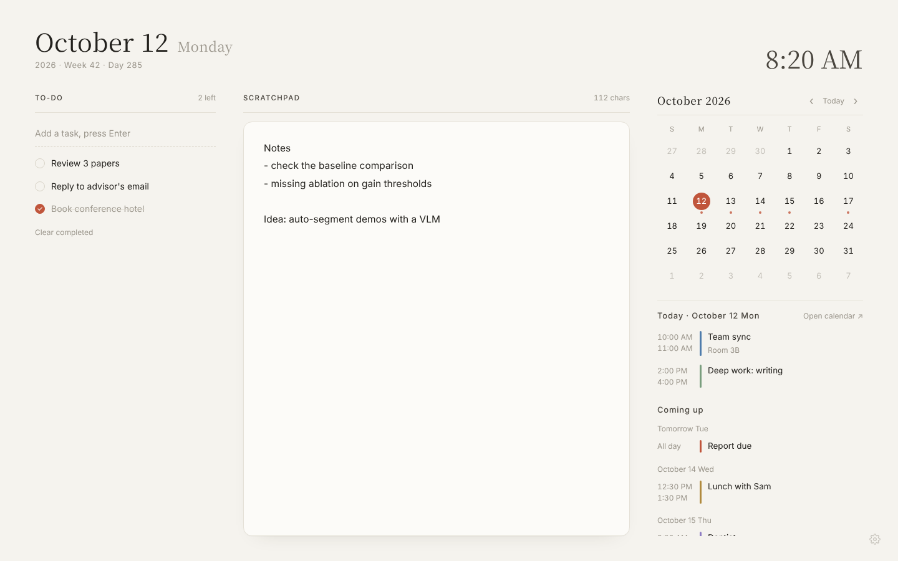

# Daypaper

A calm new tab for Chrome: a scratchpad, a to-do list and your Google Calendar on one quiet page.

**English** · [简体中文](README.zh-CN.md)



## Features

- **Scratchpad.** Autosaves as you type and stays in sync across open tabs.
- **To-do list.** Enter to add, click the circle to complete, double-click to edit. Completed items sink to the bottom.
- **Calendar.** A month view with dots on busy days, the selected day's agenda, and what is coming up in the next week. Click any event to open it in Google Calendar.
- **Light and dark** follow your system automatically.
- **English and Simplified Chinese**, following your browser or chosen in Settings. Week start (Monday or Sunday) is configurable.
- **Private by design.** Notes and to-dos never leave your browser. Calendar access is read-only and goes straight from your browser to Google, with no server in between.

## Install

Daypaper is not on the Chrome Web Store. You load it yourself:

1. Download this repository (**Code → Download ZIP**, or `git clone`) and unzip it somewhere permanent.
2. Open `chrome://extensions` and turn on **Developer mode** (top right).
3. Click **Load unpacked** and choose the `extension` folder.
4. Open a new tab. If Chrome asks whether to keep the new tab page, choose **Keep it**.

The scratchpad and to-do list work right away. The calendar needs a one-time setup below.

> Keep the folder where it is. An unpacked extension's ID comes from its folder path, and the calendar setup depends on that ID. If you move the folder, update the redirect URI in Google Cloud (step 6 below).

Built for Chrome. Other Chromium browsers that support `chrome.identity.launchWebAuthFlow`, such as Edge, should work too but are less tested.

## Connect Google Calendar

Each person uses their own Google Cloud OAuth client, so your calendar data only ever flows between your browser and Google. This takes about 10 minutes, once.

1. Go to the [Google Cloud console](https://console.cloud.google.com/) and create a project (any name).
2. Open **APIs & Services → Library**, search for **Google Calendar API** and click **Enable**.
3. Open **Google Auth Platform** (older UI: **OAuth consent screen**). If asked, click **Get started**, enter an app name and your email, choose **External**, and finish.
4. In Daypaper, click the gear icon in the bottom-right corner and copy the **Authorized redirect URI**. It looks like `https://abcdefghijklmnop.chromiumapp.org/`.
5. Back in Google Cloud, go to **Clients → Create client** (older UI: **Credentials → Create credentials → OAuth client ID**).
   - Application type: **Web application**
   - Authorized redirect URIs: paste the URI from step 4
   - Create, then copy the **Client ID** (ends with `.apps.googleusercontent.com`)
6. Paste the Client ID into Daypaper's Settings and click **Save**. A Google sign-in window opens. Choose your account and allow calendar access.
7. Go to **Audience** (older UI: on the OAuth consent screen) and do one of the following:
   - **Publish app** (recommended). You will see a "Google hasn't verified this app" screen when connecting. Click **Advanced → Go to (your app)**. This is expected for an app you built yourself.
   - Or stay in **Testing** and add your Google account under **Test users**. Google will then ask you to reconnect every 7 days.

### Troubleshooting

| Message | What to do |
| --- | --- |
| `redirect_uri_mismatch` | The redirect URI in your OAuth client does not exactly match the one in Settings. Copy it again, including the trailing `/`. |
| `access_denied` / 403 on sign-in | The app is in Testing and your account is not a test user. Add it, or publish the app. |
| Google Calendar API is not enabled | Enable it in the same project as your OAuth client (step 2). |
| Calendar access was not granted | Settings → Disconnect, then connect again and tick the calendar permission. |
| Invalid client ID | Check that the whole ID was pasted and that the client type is **Web application**. |
| A calendar is missing | Only calendars that are checked (visible) in Google Calendar are shown. |

Sign-in tokens last about an hour. Daypaper renews them silently while you are signed in to Google in this browser, and keeps showing the last loaded events if renewal fails.

## Privacy

- Notes, to-dos and settings are stored in `chrome.storage.local` on your computer only.
- The only network requests go to `accounts.google.com`, `www.googleapis.com` and `oauth2.googleapis.com`, using your own OAuth client.
- Calendar access uses the read-only scope `calendar.readonly`. Daypaper cannot create, edit or delete events.
- **Disconnect** in Settings revokes the token and clears cached events.

## Updating

Pull or re-download the repository, then click the reload icon on Daypaper's card in `chrome://extensions`. Your notes and settings are kept.

## Development

No build step. Edit the files in `extension/` and reload the extension.

```
extension/
  manifest.json      Manifest V3
  newtab.html        Page layout
  style.css          Styles, light and dark
  i18n.js            UI strings (en, zh)
  app.js             Scratchpad, to-dos, calendar, Google sign-in
  _locales/          Extension name and description
```

Opening `extension/newtab.html` directly in a browser shows a preview with sample events, handy for styling.

To add a language, add a block to `I18N` in `i18n.js`, a folder under `_locales/`, and an option in the Settings language menu.

## License

[MIT](LICENSE)
