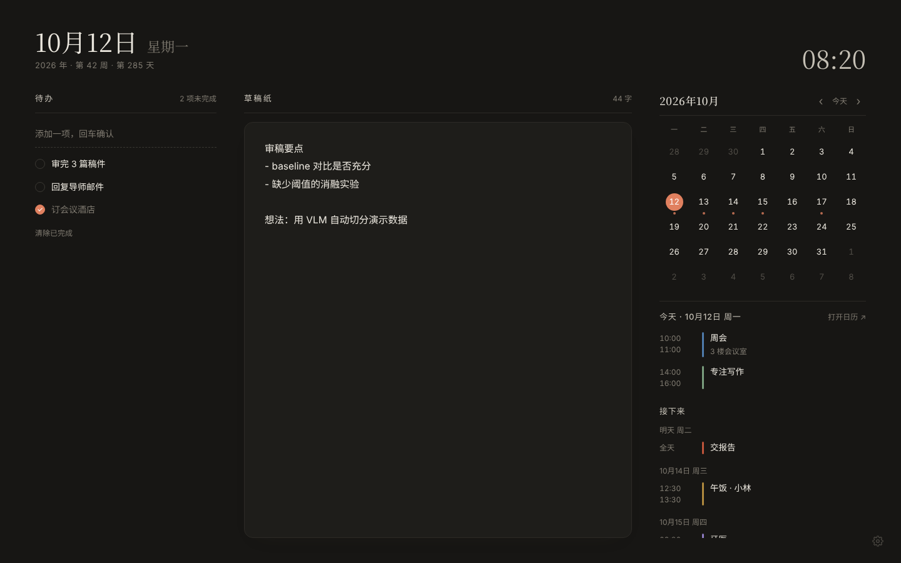

# Daypaper

一个安静的 Chrome 新标签页：草稿纸、待办清单和你的 Google 日历，放在同一页。

[English](README.md) · **简体中文**



## 功能

- **草稿纸**：边写边自动保存，多个标签页之间实时同步
- **待办**：回车添加，点圆圈完成，双击文字编辑，已完成的自动沉到底部
- **日历**：月历上有日程的日期带小圆点，下方显示所选日期的日程和之后一周的安排，点击事件直接在 Google 日历中打开
- **浅色 / 深色**自动跟随系统
- **中文和英文**，默认跟随浏览器语言，也可以在设置里切换。每周起始日（周一或周日）可调
- **注重隐私**：草稿和待办只存在你的浏览器里。日历只读，数据直接在你的浏览器和 Google 之间传输，没有任何中间服务器

## 安装

Daypaper 没有上架 Chrome 应用商店，需要手动加载：

1. 下载本仓库（**Code → Download ZIP**，或 `git clone`），解压到一个固定位置
2. 打开 `chrome://extensions`，右上角打开「开发者模式」
3. 点「加载已解压的扩展程序」，选择 `extension` 文件夹
4. 打开新标签页。如果 Chrome 询问是否保留新的新标签页，选「保留」

草稿纸和待办装好即可使用，日历需要做一次下面的配置。

> 不要移动这个文件夹。手动加载的扩展，ID 由文件夹路径决定，日历配置又依赖这个 ID。如果移动了文件夹，需要到 Google Cloud 更新重定向 URI（见下面第 6 步）。

主要在 Chrome 上开发和测试。其他支持 `chrome.identity.launchWebAuthFlow` 的 Chromium 浏览器（如 Edge）理论上也能用，但测试较少。

## 连接 Google 日历

每个人使用自己的 Google Cloud OAuth 客户端，你的日历数据只在你的浏览器和 Google 之间流动。整个过程大约 10 分钟，只需做一次。

1. 打开 [Google Cloud 控制台](https://console.cloud.google.com/)，新建一个项目（名字随意）
2. 进入「API 和服务」→「库」，搜索 **Google Calendar API**，点「启用」
3. 进入「Google Auth Platform」（旧版界面叫「OAuth 同意屏幕」）。如有提示，点「开始」，填写应用名称和你的邮箱，用户类型选「外部」，完成
4. 在 Daypaper 里点右下角的齿轮图标，复制「已获授权的重定向 URI」，形如 `https://abcdefghijklmnop.chromiumapp.org/`
5. 回到 Google Cloud，进入「客户端」→「创建客户端」（旧版界面：「凭据」→「创建凭据」→「OAuth 客户端 ID」）
   - 应用类型：**Web 应用**
   - 已获授权的重定向 URI：粘贴第 4 步复制的地址
   - 创建后复制「客户端 ID」（以 `.apps.googleusercontent.com` 结尾）
6. 把客户端 ID 粘贴到 Daypaper 设置里，点「保存」。会弹出 Google 登录窗口，选择你的账号并允许访问日历
7. 进入「目标对象」（旧版界面在 OAuth 同意屏幕页面），二选一：
   - **发布应用**（推荐）。连接时会看到"Google 尚未验证此应用"，点「高级」→「转到（你的应用名）」即可。这是自建应用的正常提示
   - 或者保持「测试」状态，在「测试用户」里加入你的 Google 账号。这种情况下 Google 每 7 天会要求重新连接一次

### 常见问题

| 提示 | 处理方法 |
| --- | --- |
| `redirect_uri_mismatch` | OAuth 客户端里的重定向 URI 和设置里显示的不完全一致。重新复制一次，注意末尾的 `/` |
| 登录时出现 `access_denied` 或 403 | 应用处于测试状态，而你的账号不在测试用户里。加进去，或者发布应用 |
| Google Calendar API 未启用 | 在 OAuth 客户端所在的同一个项目里启用它（第 2 步） |
| 没有获得日历权限 | 设置 → 断开连接，然后重新连接，并勾选日历权限 |
| 客户端 ID 无效 | 检查 ID 是否复制完整，客户端类型是否为「Web 应用」 |
| 少了某个日历 | 只显示在 Google 日历网页左侧被勾选显示的日历 |

登录凭据有效期约一小时。只要你在这个浏览器里保持 Google 登录状态，Daypaper 会在后台自动续期。续期失败时，会继续显示上次加载的日程。

## 隐私

- 草稿、待办和设置只保存在你电脑上的 `chrome.storage.local` 中
- 网络请求只发往 `accounts.google.com`、`www.googleapis.com` 和 `oauth2.googleapis.com`，使用的是你自己的 OAuth 客户端
- 日历使用只读权限 `calendar.readonly`，Daypaper 无法创建、修改或删除日程
- 设置里的「断开连接」会撤销授权并清除缓存的日程

## 更新

拉取或重新下载仓库后，在 `chrome://extensions` 里点 Daypaper 卡片上的刷新按钮。草稿和设置不会丢失。

## 开发

没有构建步骤，直接修改 `extension/` 里的文件，然后刷新扩展即可。

```
extension/
  manifest.json      Manifest V3
  newtab.html        页面结构
  style.css          样式（浅色 / 深色）
  i18n.js            界面文案（en、zh）
  app.js             草稿纸、待办、日历、Google 登录
  _locales/          扩展名称和描述
```

直接用浏览器打开 `extension/newtab.html` 会用示例日程展示页面，调样式时很方便。

## 许可证

[MIT](LICENSE)
